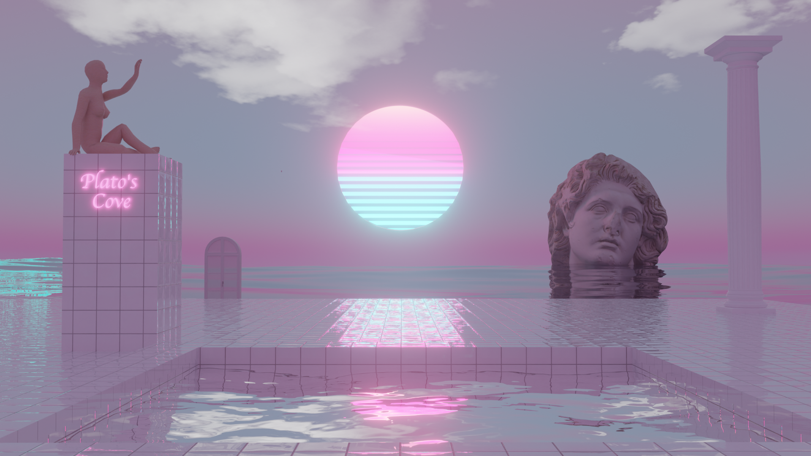

# Plato's Cove

A first-person **vaporwave 3D experience** — a liminal poolroom platform drifting on an endless ocean at golden hour, with a recessed pool, doric columns, a marble bust on a pedestal, and a boombox playing lo-fi tracks. Walk around, jump, and let the chromatic-aberrated, bloom-soaked sunset wash over you.



## The experience

- **Endless ocean** — animated `three.js` `Water` stretching to the horizon
- **Procedural sky** — custom GLSL shader with a low, hazy sun and graded vaporwave colors
- **Floating poolroom** — a tiled platform with a recessed pool of reflective water
- **Set dressing** — doric columns and a marble bust raised on a tall pedestal
- **Diegetic music** — a boombox plays vaporwave/lo-fi tracks; volume fades with your distance to it, and controls appear when you walk close
- **The door** — the freestanding door opens onto the cave: a closed-down hotel conference room where rows of empty chairs face a wall of CRTs tuned to *Plato TV*, a live broadcast of the island that cuts between shots of the sun, the statues, the pool and the door you came through, with captions, a ticker and the occasional stand-by card. The music follows you in, playing tinny out of the TVs over the room's hum and air handling
- **Further back** — the cave has more than one door. What's behind the second one is best found in person; the music follows you there too, in a room of its own. (Spoilers, and notes for contributors, are in [docs/WORLD.md](docs/WORLD.md).)
- **A door that doesn't belong** — every world also has a glass door that looks like it came from somewhere else entirely. They all lead to the same place, and from there you can get anywhere, upstairs included. It loads only when you first need it
- **First-person walk camera** — custom kinematic controller with acceleration, gravity, and jumping
- **Vaporwave grade** — bloom, chromatic aberration, film noise, and vignette, per world (not every world gets it)

|                               |                                 |
| ----------------------------- | ------------------------------- |
|  |  |
|  |                                 |

## Tech stack

- **React 19** + **Vite 7** — fast dev server and build
- **Three.js** via **React Three Fiber** — 3D rendering
- **@react-three/drei** — R3F helpers (`useGLTF`, `Text`)
- **@react-three/postprocessing** — bloom, chromatic aberration, noise, vignette
- **vite-plugin-glsl** — imports the sky `.glsl` shaders
- **Leva** — dev-only tweak panel for lights and effects
- **Playwright** — headless screenshot capture

## Getting started

```bash
# Install dependencies
npm install

# Start development server
npm run dev
```

Then open http://localhost:3000 in your browser. Click the canvas to capture the mouse and look around.

## Controls

| Key   | Action             |
| ----- | ------------------ |
| W / ↑ | Move forward       |
| S / ↓ | Move backward      |
| A / ← | Strafe left        |
| D / → | Strafe right       |
| Mouse | Look around        |
| Space | Jump               |
| Esc   | Release mouse      |
| P     | Play / pause music |
| E     | Next track         |
| M     | Mute / unmute      |
| Click / Enter | Open a door you're facing |
| F     | Fullscreen         |

## Project structure

```
src/
├── main.tsx              # Entry point
├── App.tsx               # Canvas, camera, tone mapping, Leva panel
├── shaders/
│   ├── sky.vert.glsl     # Sky dome vertex shader
│   ├── sky.frag.glsl     # Procedural sunset / sky color
│   └── crt.*.glsl        # CRT screen: curvature, scanlines, static
└── components/
    ├── Scene.tsx         # Mounts every world, shows the current one; per-world
    │                     #   fog, camera near plane and acoustics
    ├── worldStore.ts     # Current world, which door leads where, and the
    │                     #   transition between worlds (outside Canvas)
    ├── levels.ts         # Floors (and upper floors), bounds, colliders, spawn
    │                     #   and per-door arrival points for each world
    ├── DoorTrigger.tsx   # "At this door and looking at it" detection
    ├── IslandFeed.tsx    # "Plato TV": island shots + broadcast graphics for the CRTs
    ├── Effects.tsx       # Per-world post: bloom, chromatic aberration, vignette, noise
    ├── player/           # First-person walk controller
    ├── island/           # Ocean, sky, platform + pool, sign, props
    ├── cave/             # Conference room, procedural carpet/wallpaper,
    │                     #   CRT video wall, chairs, EXIT sign, staff door
    ├── stockroom/        # The world behind the staff door: room shell,
    │                     #   stock, procedural textures, fitted model clones
    ├── mall/             # The glass doors and the world behind them (lazy-loaded;
    │                     #   spoilers in docs/WORLD.md)
    ├── MusicPlayer.tsx   # Boombox: distance-based volume, proximity detection
    ├── musicStore.ts     # Tracks, play/pause/mute, Web Audio acoustics per world
    │                     #   (open air, TV speaker, PA + hall reverb, ceiling
    │                     #   speakers + atrium reverb) + ambience
    └── UI.tsx            # HUD, music controls, door prompt, fade overlay

docs/
└── WORLD.md              # World bible: concept, rules, log of each round (spoilers)

public/
├── models/               # GLB props (bust, columns, boombox, ...)
├── textures/             # PBR textures (floor tiles, pool tiles, water normals)
├── sounds/music/         # Vaporwave / lo-fi tracks
└── fonts/                # Italianno display font
```

## Screenshots & QA

A headless capture tool renders the running scene to a PNG:

```bash
npm run dev                                            # serves :3000
npm run shot -- --out screenshots/sun.png --pitch 0.05 # capture a frame
```

Appending `?qa=1` to the URL hides the Leva panel and HUD for clean captures, and `?world=cave`, `?world=stockroom` or `?world=mall` starts in that world. In QA mode, `window.travel("cave")` (and so on) goes through a door from the console. See `scripts/shot.mjs` for all flags (`--yaw`, `--pitch`, `--x`/`--z`, `--frames`, etc.). If Playwright's bundled browser isn't installed, point `CHROMIUM_PATH` at a Chromium binary.

To check that every door works the way a player uses it (stand at it, look at it, open it, arrive in front of the right door on the other side), run the door test against the dev server:

```bash
CHROMIUM_PATH=/path/to/chrome node scripts/door-test.mjs
```

## Credits

### Music

all tracks generated with [Suno](https://suno.com/).

### 3D Models

- Boombox: [Retro Boombox](https://sketchfab.com/3d-models/boombox-0159214a415c49c89f85f1f336ce571a) by [ChoboiAssets](https://sketchfab.com/alsoliman905) (CC Attribution)
- Doric column: [Doric Column](https://sketchfab.com/3d-models/doric-pillar-f5be847e525e401299f2a119372edd18) by [lcoyne](https://sketchfab.com/lcoyne) (CC Attribution)
- Helios Vaporwave Bust: [Helios Vaporwave Bust](https://sketchfab.com/3d-models/helios-vaporwave-bust-f7a0fdfc6bef44b497e33257658764c8) by [fil0s0v](https://sketchfab.com/fil0s0v) (CC Attribution)
- **Textures** — tile, water-normal, and surface maps. _TODO: confirm sources/licenses._
- **Font** — [Italianno](https://fonts.google.com/specimen/Italianno) (Google Fonts, SIL Open Font License).
- **Downloaded assets** — files from asset libraries such as [Poly Haven](https://polyhaven.com) (CC0) are listed, with source, author and license, in [ASSETS.md](ASSETS.md). There are none at the moment.

## License

Released under the [MIT License](LICENSE).

Note: third-party assets (music, 3D models, textures, fonts) listed above are covered by their own respective licenses, not the MIT license above.
